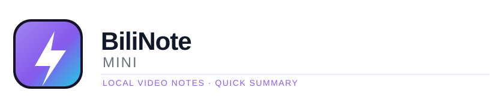

<p align="center">
  
</p>

<p align="center">
  <strong>Local-first video notes, transcripts and quick summaries.</strong><br />
  Windows installer · Chrome extension · Bilibili / YouTube / Instagram / Zhihu
</p>

<p align="center">
  <a href="https://github.com/hyc3z/BiliNote-mini/releases/tag/v0.7.6">v0.7.6</a>
  ·
  <a href="integrations/chrome-extension/README.md">Chrome extension 0.6.4</a>
  ·
  <a href="LICENSE">License</a>
</p>

<p align="center">
  <a href="#简体中文">简体中文</a> · <a href="#english">English</a>
</p>

---

## 简体中文

### 这是什么

BiliNote Mini 是一个本地优先的视频笔记工具。它优先读取 B 站字幕；没有字幕时下载音轨并用本地 Whisper 转录，再调用兼容 OpenAI 的接口生成带时间戳的中文笔记、逐字稿和摘要。数据保存在本机，只有文字总结会发送到你配置的模型接口。

### 功能

- **B 站**：字幕优先、多分 P / 合集选择、批量整理、评论采集与分析。
- **YouTube / Instagram**：单个视频 / Shorts / Reels；无字幕时走音频转录。
- **本地资料库**：标题、摘要、逐字稿全文搜索；支持按时间归组、批量视图与深链 `#task=<id>`。
- **术语校正**：为视频绑定领域词表，校正逐字稿后重新总结。
- **Chrome 扩展**：B 站 / YouTube 右键“省流不看”；工具栏徽标显示未完成任务数量，完成后显示 ✓。
- **知乎判断**：问题页右键“BiliNote 判断”，自动按选中文字 / 回答 / 问题判断，页面内显示结论、可取之处、不足之处、值得思考点和需核实项。
- **Windows 托盘**：原生 `BiliNoteMiniTray.exe`，管理后端、打开工作台、查看日志、开关自启动和退出；安装器支持开机登录任务。
- **模型设置**：默认填入 DeepSeek 接口 `https://api.deepseek.com` 和模型 `deepseek-chat`，也可以改成其他兼容 OpenAI 的接口。

### Windows 安装（推荐）

从 [Releases](https://github.com/hyc3z/BiliNote-mini/releases/tag/v0.7.6) 下载：

- `BiliNoteMini-Setup-0.7.6.exe`：按当前用户安装，不需要管理员权限；
- `BiliNoteMini-0.7.6-Setup.zip`：ZIP 备用安装包，解压后运行 `install.cmd`。

安装器会把程序放到 `%LOCALAPPDATA%\BiliNote Mini`（若目录被安全策略拒绝，会自动尝试其他可写目录或提示用 `/DIR=` 指定），使用内置 `uv` 准备 Python 3.12 和依赖，创建 `Start-BiliNoteMini.cmd` / `Open-BiliNoteMini.cmd` / `Stop-BiliNoteMini.cmd`，并尝试创建托盘和登录自启动。

Windows 11 新托盘图标默认在任务栏右下角的 `^` 溢出区；也可以在“设置 → 个性化 → 任务栏 → 其他系统托盘图标”里打开。若机器禁止写 Desktop / AppData / HKCU，快捷方式和自启动可能被跳过；安装器会打印警告，此时使用安装目录里的启动脚本即可。

### 开发启动

需要 64 位 Python 3.11/3.12、Node.js 和 pnpm。

```powershell
cd backend
py -3.12 -m venv .venv
.\.venv\Scripts\python.exe -m pip install -r requirements.txt
cd ../BillNote_frontend
pnpm install --frozen-lockfile
cd ..
.\start-mini.ps1
```

打开 `http://127.0.0.1:3015`。安装版由后端在 `http://127.0.0.1:8483` 直接托管前端。

后端通过 `imageio-ffmpeg` 自带 ffmpeg，不需要单独安装系统 ffmpeg；也可以设置 `FFMPEG_LOCATION` 指向系统二进制。NVIDIA GPU 可额外安装 `backend/requirements-gpu.txt`，然后在设置里选择 GPU。

### 配置

- 模型接口地址默认 `https://api.deepseek.com`；
- 模型名称默认 `deepseek-chat`；
- 首次使用只需填写自己的 DeepSeek API Key；
- B 站 Cookie 可在设置页手动填写，或在 Chrome 扩展弹窗里点“同步”；
- 数据、配置、模型和日志都在 `backend/data`、`backend/config`、`backend/models`、`backend/logs`。

### Chrome 扩展

扩展源码在 [`integrations/chrome-extension`](integrations/chrome-extension)。安装方式：

- 解压 `BiliNoteMini-Extension-0.6.4.zip`，在 `chrome://extensions` 以“加载已解压的扩展程序”加载；
- 或使用本地构建的 CRX。Chrome 对商店外 CRX 有限制，ZIP 方式更稳定。

默认后端地址 `http://127.0.0.1:8483`，安装版工作台也是 `http://127.0.0.1:8483`；开发时可在扩展选项里改成 `3015`。详细说明见扩展 README。

### 构建与发布

```powershell
powershell -ExecutionPolicy Bypass -File packaging\build-release.ps1
```

会构建前端、原生托盘、安装器、安装 ZIP 和扩展 ZIP/CRX。产物在 `dist/release/`。首次构建会下载 `uv.exe` 到 `packaging/vendor/`；CRX 私钥保存在 `packaging/keys/`，不会提交到仓库。

HTML/JS 校验：

```powershell
cd BillNote_frontend
pnpm exec tsc -p tsconfig.app.json --noEmit
pnpm build
```

后端测试：

```powershell
cd backend
.\.venv\Scripts\python.exe -m unittest discover -s tests -p 'test_*.py'
```

### 目录结构

```text
backend/                         FastAPI 后端、下载、转录、SQLite
BillNote_frontend/               React/Vite 工作台
integrations/chrome-extension/   Chrome 扩展
packaging/                       托盘、安装器、构建脚本
docs/                            Logo 等文档资源
dist/release/                    发布产物（本地生成）
```

### 隐私

- 视频、音频、Cookie、配置和笔记只保存在本机；不会自动上传到第三方服务。
- 文字总结和知乎判断会发送到你配置的模型供应商，这是功能本身所需。
- 仓库不包含用户截图、Cookie、API Key 或 CRX 私钥；README 使用 Logo 和文字，不使用真实浏览/任务数据。
- 运行数据目录（`backend/data`、`config`、`logs`、`models`、`note_results`）已加入忽略规则。

### License

保留上游 [LICENSE](LICENSE)。

---

## English

### What it is

BiliNote Mini is a local-first video note tool. It prefers Bilibili subtitles, falls back to audio download plus local Whisper transcription, and asks an OpenAI-compatible model for timestamped Chinese notes, transcripts and summaries. Everything stays on your machine except the text sent to the model endpoint you configure.

### Features

- **Bilibili**: subtitle-first processing, multi-part / collection selection, batch jobs, comment collection and analysis.
- **YouTube / Instagram**: single video / Shorts / Reels; audio transcription when subtitles are unavailable.
- **Local library**: full-text search over titles, summaries and transcripts; time grouping, batch view and `#task=<id>` deep links.
- **Terminology correction**: bind domain glossaries, correct transcripts and re-summarize.
- **Chrome extension**: right-click “省流不看” on Bilibili / YouTube; the toolbar badge shows the number of unfinished tasks and ✓ when done.
- **Zhihu judging**: right-click “BiliNote 判断” on a question page. It infers selected text / answer / question and shows a verdict, strengths, weaknesses, further thoughts and claims to verify in-page.
- **Windows tray**: native `BiliNoteMiniTray.exe` for backend control, workbench, logs, autostart and exit; the installer can register a logon task.
- **Model defaults**: DeepSeek endpoint `https://api.deepseek.com` and model `deepseek-chat` are pre-filled; any OpenAI-compatible endpoint works.

### Windows install (recommended)

Download from [Releases](https://github.com/hyc3z/BiliNote-mini/releases/tag/v0.7.6):

- `BiliNoteMini-Setup-0.7.6.exe` — per-user install, no administrator required;
- `BiliNoteMini-0.7.6-Setup.zip` — portable ZIP; extract and run `install.cmd`.

The installer uses `%LOCALAPPDATA%\BiliNote Mini` (or another writable fallback, or a custom `/DIR=`), prepares Python 3.12 and dependencies with the bundled `uv`, creates `Start-BiliNoteMini.cmd` / `Open-BiliNoteMini.cmd` / `Stop-BiliNoteMini.cmd`, and attempts to install the tray and logon autostart.

On Windows 11, new tray icons are placed in the `^` overflow area by default. If the machine blocks writes to Desktop / AppData / HKCU, shortcuts and autostart may be skipped; the installer prints warnings and the scripts in the install directory still work.

### Development

Requires 64-bit Python 3.11/3.12, Node.js and pnpm.

```powershell
cd backend
py -3.12 -m venv .venv
.\.venv\Scripts\python.exe -m pip install -r requirements.txt
cd ../BillNote_frontend
pnpm install --frozen-lockfile
cd ..
.\start-mini.ps1
```

Open `http://127.0.0.1:3015`. The installed build serves the frontend from the backend at `http://127.0.0.1:8483`.

`imageio-ffmpeg` provides ffmpeg out of the box; optionally set `FFMPEG_LOCATION` to a system binary. NVIDIA users can install `backend/requirements-gpu.txt` and select GPU in settings.

### Configuration

- Endpoint default: `https://api.deepseek.com`
- Model default: `deepseek-chat`
- Enter your own DeepSeek API key once;
- Bilibili Cookie can be pasted in settings or synced from the extension popup;
- Data/config/models/logs live under `backend/data`, `backend/config`, `backend/models`, `backend/logs`.

### Chrome extension

Source: [`integrations/chrome-extension`](integrations/chrome-extension).

- Extract `BiliNoteMini-Extension-0.6.4.zip` and load it from `chrome://extensions` with “Load unpacked”;
- or use a locally built CRX. Off-store CRX files are restricted by Chrome; ZIP is more reliable.

The default backend URL is `http://127.0.0.1:8483`; the installed workbench is also served there. For Vite development, change it to `3015` in the extension options. See the extension README for details.

### Build and release

```powershell
powershell -ExecutionPolicy Bypass -File packaging\build-release.ps1
```

Builds the frontend, native tray, installer, setup ZIP and extension ZIP/CRX into `dist/release/`. The first build downloads `uv.exe` to `packaging/vendor/`; the CRX private key stays in `packaging/keys/` and is never committed.

Frontend checks:

```powershell
cd BillNote_frontend
pnpm exec tsc -p tsconfig.app.json --noEmit
pnpm build
```

Backend tests:

```powershell
cd backend
.\.venv\Scripts\python.exe -m unittest discover -s tests -p 'test_*.py'
```

### Project layout

```text
backend/                         FastAPI backend, downloaders, transcription, SQLite
BillNote_frontend/               React/Vite workbench
integrations/chrome-extension/   Chrome extension
packaging/                       tray, installer, release scripts
docs/                            logo and documentation assets
dist/release/                    generated release artifacts
```

### Privacy

- Videos, audio, cookies, settings and notes stay local; nothing is uploaded automatically.
- Text summaries and Zhihu judging are sent to the model provider you configure; that is required for the feature.
- The repository contains no user screenshots, cookies, API keys or CRX private keys. The README uses a logo and text only, not real browsing/task data.
- Runtime directories (`backend/data`, `config`, `logs`, `models`, `note_results`) are ignored by Git.

### License

Upstream [LICENSE](LICENSE) retained.
